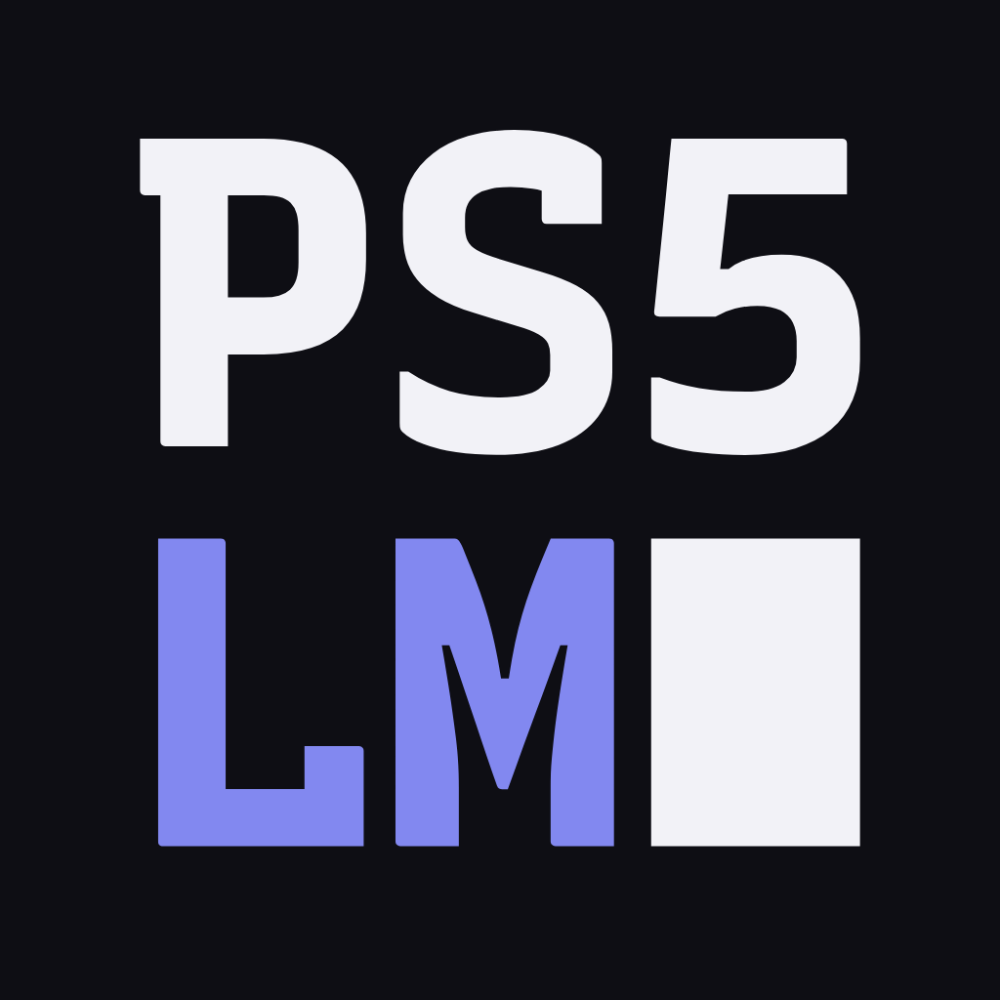

# PS5LM logo

The name on a mono grid: **PS5** over **LM**, and the text cursor in the cell under the 5, as if the console were
still typing. The letters are the site's Recursive Mono, outlined, so the files need no fonts.

<p>
  
  &nbsp;
  
</p>

## Versions

| Version | Use it for | Files |
|---|---|---|
| Stacked | The app icon, avatars, the site footer, anything square | `ps5lm-stacked-*.svg` |
| Horizontal | The site header, banners, the social image, anything wide | `ps5lm-horizontal-*.svg` |
| Icon | The stacked logo on the ground colour, full bleed: PS5 home screen (`icon0.png`), web app icons | `ps5lm-icon.svg` |
| Small icon | Heavier letters, less margin, for 48 px and below: favicons | `ps5lm-icon-small.svg` |

Each logo comes in four colourings:

- `-dark`: for dark grounds. PS5 and the cursor in ink, LM in periwinkle. Set a step lighter (weight 760),
  because light letters on a dark ground look heavier.
- `-light`: for light grounds. PS5 and the cursor in ground black, LM in periwinkle (weight 800).
- `-black` and `-white`: one colour, for print, engraving, and grounds the two colours can't sit on.

Wide formats, the horizontal logo low on the right over the site's grid and periwinkle glow:

| File | Size | Where it goes |
|---|---|---|
| `ps5lm-og.svg` | 1200×630 | `site/media/og.jpg`, the link preview (`og:image`) |
| `ps5lm-social.svg` | 1280×640 | GitHub's social preview, `png/ps5lm-social-1280x640.png`. Upload it by hand under Settings > General > Social preview |
| `ps5lm-background.svg` | 3840×2160 | The PS5 home screen background, `ps5/app/sce_sys/source/background.svg` |

Other folders:

- `png/`: PNG copies of the logos and the social preview.
- `web/`: favicon and app icons for any web page: `favicon.ico` (16, 32, 48), `favicon-64.png`, `apple-touch-icon.png`
  (180), `icon-192.png` and `icon-512.png`.
- `presentation/`: the logo shown in use: README, app icon, website, terminal, sticker, social profile.

The app's `ps5/app/sce_sys/source/icon.svg` and `background.svg` are copies of `ps5lm-icon.svg` and
`ps5lm-background.svg`. `scripts/render-artwork.sh` turns them into PNGs. `site/media/logo.svg` is
`ps5lm-horizontal-dark.svg`. For colours, type and components on web pages, see [`DESIGN.md`](../DESIGN.md).

To redraw everything after a change to the font or the layout:

```bash
uv run --with fonttools --with brotli --with skia-pathops python brand/build.py brand
```

## Colour

| Name | HEX | RGB | Role |
|---|---|---|---|
| Ground | `#0e0e14` | 14 14 20 | The page, the icon tile |
| Panel | `#16161d` | 22 22 29 | One step up: panels, code, the footer |
| Ink | `#f2f2f7` | 242 242 247 | Text on the ground; PS5 and the cursor |
| Periwinkle | `#8288f0` | 130 136 240 | The one accent: LM, the primary button, links |
| Muted | `rgba(235, 235, 245, 0.6)` | | Secondary text |

Periwinkle on the ground is 6.2:1. On white it is 3.1:1: fine for the logo, too low for body text. Text set on
periwinkle is ground black, never white.

## Clear space and size

- Keep clear space of **half a letter's height** on every side. It scales with the logo.
- Smallest horizontal logo: 16 px tall on screen, 4 mm in print.
- Smallest stacked logo: 32 px on screen, 12 mm in print. Below 48 px use `ps5lm-icon-small.svg`. At 16 px
  the favicon is a shape you know, not letters you read.

## Type

Recursive, self-hosted from `site/assets/fonts` under the SIL Open Font License:

- **Recursive Mono**, bold: the logo, headings, labels, buttons.
- **Recursive Sans**: body text.

## Don't

- Stretch, rotate, outline, shadow or add a gradient or glow to the logo.
- Recolour it outside the palette, or swap the colours of PS5 and LM.
- Rearrange the parts: the cursor stays under the 5, or after the M on one line.
- Type the name in a font instead of using the files.
- Put the two-colour logo on a busy photo. Use the icon tile there.
- Use PlayStation's button symbols, logo or console shapes next to it. PS5LM isn't affiliated with Sony.
